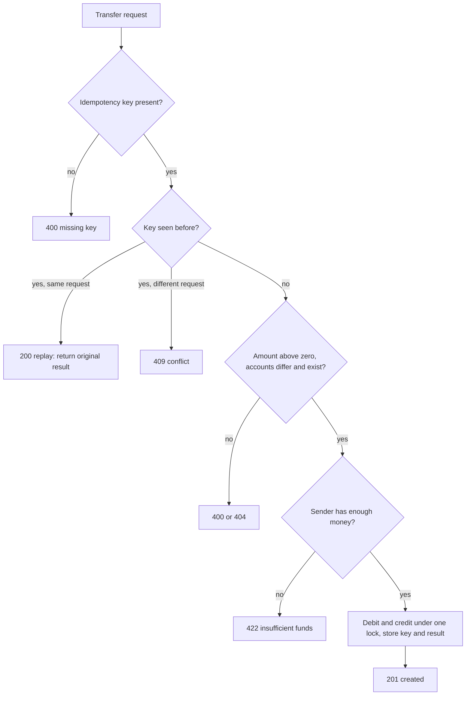

# Ledger

A small payments ledger service written in Go. Accounts hold balances in pence, and transfers between them are safe under concurrent requests. Duplicate payments are prevented using idempotency keys, so a client can retry a request without being charged twice.

It's a learning project: I wanted to understand the problems a payments backend has to get right (money must never be created or lost, and a retry must never move money twice) and to learn Go while building it.

## Basic requirements
- Create accounts and transfer money between them
- Balances can never go negative, and total money is conserved across every transfer
- Idempotency: a repeated request must not move money twice
- Safe under concurrent requests
- A small HTTP API with sensible status codes
- Automated tests, including concurrency tests, run in CI
- Containerised with Docker

## Design
The code is split into two packages. `internal/ledger` holds the business rules and knows nothing about HTTP. `internal/api` handles HTTP and delegates every decision to the ledger. Keeping them apart meant I could test the rules directly, without going through a server.

### Transfer flow
The order of the checks matters. The idempotency lookup comes before the balance check, so a retry of a payment that already succeeded is still treated as a replay, even if the sender can no longer afford it now.



### Key decisions
- Money is stored as an integer number of pence to prevent floating-point errors. Floats can't represent many decimal values exactly, so errors can cause a profit or loss for one party when large amounts are transferred. Even tiny errors on small transactions accumulate over a long period of use, which can cause accounting and tax discrepancies.
- One mutex guards all state. The debit and the credit happen inside the same critical section, so no other request can observe money that has left one account but not yet arrived in the other. This is correct and simple, but it serialises every request.
- The total is an invariant. Money only moves, it is never created or destroyed. `Total()` sums every balance, and the concurrency tests assert that it never changes.
- Sentinel errors. The ledger returns named errors (`ErrAccountNotFound`, `ErrInsufficientFunds`, and so on). The API maps them to HTTP status codes in one place using `errors.Is`, so each endpoint returns the same status for the same failure.

### Tech stack choice

- Go: goroutines and the `sync` package are built into the language, which made it a good way to learn concurrency, and it's widely used for backend services.
- Standard library `net/http`: Go 1.22 added method and wildcard routing (`GET /accounts/{id}`), which covers three routes without needing a web framework.
- In-memory store: a `map` guarded by a `sync.Mutex`. It's the simplest thing that's correct, and I kept the storage behind the `Ledger` type so it could be swapped for a database later.
- Go's `testing` package and `httptest`: table-driven tests for the rules, and `httptest` to exercise the HTTP handlers without starting a real server.
- Docker: a multi-stage build compiles the binary in one image and copies it into a small runtime image.
- GitHub Actions: runs `go vet`, `go test -race` and a build on every push. The race detector needs cgo, which isn't set up on my Windows machine, so CI is where it runs.

## Running the ledger

You need [Go](https://go.dev/dl) 1.22 or newer.

```bash
go run ./cmd/ledgerd
```

The server starts on `http://localhost:8080`. Set the `ADDR` environment variable to change the port.

To run it in a container:

```bash
docker build -t ledger .
docker run --rm -p 8080:8080 ledger
```

### Trying it out

Amounts are in pence, so `1000` is £10.00.

```bash
curl -X POST localhost:8080/accounts -d '{"id":"alice","opening_balance":1000}'
curl -X POST localhost:8080/accounts -d '{"id":"bob","opening_balance":0}'

curl -X POST localhost:8080/transfers \
  -H 'Idempotency-Key: pay-1' \
  -d '{"from":"alice","to":"bob","amount":250}'

curl localhost:8080/accounts/alice
```

Send the same transfer a second time: the response is `200` with the same transfer ID, and alice's balance is unchanged.

### API

| Method | Path | Notes |
|---|---|---|
| POST | `/accounts` | `{"id","opening_balance"}`: 201, 400, 409 |
| POST | `/transfers` | needs an `Idempotency-Key` header: 201 new, 200 replay, 400, 404, 409, 422 |
| GET | `/accounts/{id}` | 200, 404 |

Errors are returned as `{"error":"message"}`.

## Testing

```bash
go test ./...
```

The tests cover:

- Business rules: bad amounts, unknown accounts, duplicate accounts, insufficient funds
- Idempotency: a replay returns the original result and moves no money, a reused key with different details is rejected, and a replay still succeeds when a fresh request would now fail
- Concurrency: 100 goroutines make random transfers between accounts and the total never changes and no balance goes negative; 50 goroutines send the same request at once and exactly one transfer happens
- HTTP layer: each endpoint returns the right status code and body

The concurrency tests are the ones I learned the most from. I first reproduced the underlying problem in a small experiment: 1000 goroutines incrementing an unprotected counter regularly finished below 1000, which is a lost update caused by a data race. Adding a mutex fixed it, and I ran the tests repeatedly (`go test -count=20`) to check that the locking held.

## Future additions

### Known issues

- State is in memory. A restart loses everything.
- No authentication or authorisation. This was out of scope for a project about the core transfer logic.
- A failed transfer isn't remembered. If a client retries the same key after the account has funds, it goes through as a fresh transfer. This was a deliberate choice, but a real system might record failures too.
- The idempotency map grows forever. Old keys are never expired.
- A single global lock. Every request waits for every other one.
- Single currency. All amounts are in pence.

### Todo

- Persist data in Postgres, with each transfer in a single transaction
- Replace the global lock with per-account locking, always acquired in sorted ID order so two opposite transfers can't deadlock
- Expire old idempotency keys
- Add request timeouts, graceful shutdown and structured logging
- Increase test coverage and add fuzz tests for request parsing
- Authentication
- Publish transfer events through a transactional outbox, and run multiple instances behind a load balancer

## Useful reading

- Go 1.22 routing: https://go.dev/blog/routing-enhancements
- The Go data race detector: https://go.dev/doc/articles/race_detector
- Table-driven tests in Go: https://go.dev/wiki/TableDrivenTests
- Designing robust and predictable APIs with idempotency (Stripe): https://stripe.com/blog/idempotency